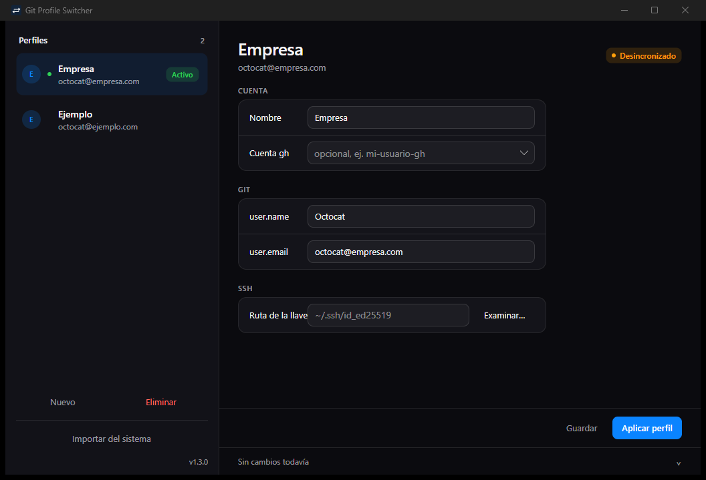

# Git Profile Switcher



[](https://github.com/Canopus44/git-profile-switcher/actions/workflows/build.yml)

App de escritorio (Avalonia / .NET 10) para guardar perfiles de git y cambiar entre ellos con un clic.

## Funciones

- Crear, editar y eliminar perfiles con nombre, `git user.name`, `git user.email`, ruta de llave SSH y cuenta de `gh` (ambos opcionales).
- Importar automáticamente los perfiles que ya tienes configurados en git y SSH.
- Aplicar un perfil: actualiza la config global de git, el bloque gestionado de `~/.ssh/config` y cambia la cuenta activa de `gh`.
- Cambiar de perfil desde el icono de la bandeja del sistema, sin abrir la ventana.
- Cerrar la ventana la oculta en la bandeja; la app sigue en ejecución hasta elegir **Salir**.
- Muestra el perfil activo y avisa si `git config --global user.email` no coincide con el perfil.
- Reporte paso a paso de cada aplicación (✓ / ⚠ / ✕).
- Interfaz de escritorio al estilo de Ajustes de macOS, con barra lateral de perfiles y validación en línea.

## Detección automática

La primera vez que abres la app (sin perfiles guardados) lee tu configuración existente y la importa. También puedes pulsar **Importar del sistema** cuando quieras; solo agrega perfiles cuyo email no esté ya en la lista.

- `~/.gitconfig` y sus bloques `includeIf "gitdir:..."`: toma `user.name` / `user.email` de cada configuración incluida y nombra el perfil según el archivo (`.gitconfig-work` → Work).
- `~/.ssh/id_*` (sin `.pub`): asocia la llave al perfil cuando el sufijo coincide (`id_ed25519_work` → Work).
- `hosts.yml` de GitHub CLI: ofrece las cuentas `gh` existentes en el desplegable del perfil.

Todo es solo lectura: nada se modifica hasta que pulses **Aplicar perfil**. Nunca se leen ni se guardan tokens; de `hosts.yml` solo se toman los nombres de usuario.


## Requisitos

- **git** obligatorio, disponible en `PATH`.
- **gh** (GitHub CLI) opcional: solo se usa si el perfil define una cuenta.
- Windows 10/11, Linux x64 o macOS arm64.

## Instalación

**Windows**: descarga `Setup.exe` desde [Releases](../../releases) y ejecútalo.

**Linux / macOS**: descarga el archivo del job de Actions (artefactos `app-linux-x64` / `app-osx-arm64`), descomprime y da permisos:

```bash
chmod +x GitProfileSwitcher
./GitProfileSwitcher
```

## Uso

1. Pulsa **Nuevo**, completa nombre, usuario y email de git (llave SSH y cuenta `gh` son opcionales) y **Guardar**.
2. Pulsa **Aplicar perfil**.

Al aplicar, exactamente:

- `git config --global user.name "<valor>"` y `git config --global user.email "<valor>"`, con verificación posterior del email.
- Si el perfil tiene llave SSH: escribe/actualiza un bloque gestionado en `~/.ssh/config` para `Host github.com` (`IdentityFile`, `IdentitiesOnly yes`). Si ya existe un `Host github.com` manual fuera del bloque, no lo toca y reporta el conflicto.
- Si el perfil tiene cuenta `gh` y `gh` está instalado: `gh auth switch --user <cuenta>`.

## Bandeja del sistema

Mientras la app está abierta muestra un icono en la bandeja del sistema:

- **Menú de perfiles**: un ítem por perfil, con el activo marcado. Al elegirlo se aplica el mismo flujo que **Aplicar perfil** y se actualizan la ventana y el tooltip.
- **Abrir Git Profile Switcher**: muestra y activa la ventana (clic izquierdo en el icono hace lo mismo).
- **Salir**: cierra la app por completo.

Cerrar la ventana con la X ya no termina el proceso: la oculta en la bandeja. Para salir de verdad usa **Salir** en el menú de la bandeja.

En Linux el icono requiere `libappindicator` y soporte DBusMenu (por ejemplo `libayatana-appindicator3-1` según la distro). Si no está disponible, la app sigue funcionando normalmente con la ventana.

## Dónde se guardan los perfiles

`profiles.json` en la carpeta de configuración del usuario:

- **Windows**: `%APPDATA%\GitProfileSwitcher\profiles.json`
- **macOS**: `~/Library/Application Support/GitProfileSwitcher/profiles.json`
- **Linux**: `$XDG_CONFIG_HOME/GitProfileSwitcher/profiles.json` (por defecto `~/.config/GitProfileSwitcher/profiles.json`)

## Limitaciones

- Cambia el estado **global** de la máquina: afecta a todos los repositorios que no tengan configuración propia.
- Si usas `includeIf` por carpeta en tu config de git, esa regla manda sobre el valor global.
- `gh` es opcional; sin él solo se configura git y SSH.
- Los instaladores y binarios **no están firmados**: Windows SmartScreen mostrará una advertencia y macOS puede pedir confirmación al abrir.

## Build local

```bash
dotnet build
dotnet test
```

Instalador de Windows (requiere PowerShell 7; instala `vpk` si falta):

```powershell
pwsh scripts/build-installer.ps1
```

Salida en `Releases/` (`Setup.exe`, `*-full.nupkg`, `RELEASES`, portable zip).

## Licencia

MIT. Autor: Canopus44.
